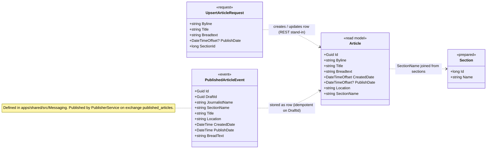

# L4 – ArticleService: models

Code-level view of the model layer in `apps/article_service/src/ArticleService/Models/Article.cs`,
plus the event it consumes from the shared Messaging library.
See the L3 view `ArticleServiceComponents` in Structurizr for how the components use these models.

## Notes

- **`Article`** is what the API returns. `ArticleReadRepository` builds it by joining the
  `articles` and `sections` tables, so the section is exposed by name.
- **`Id`** is a `Guid` (since migration `V5__article_id_to_uuid.sql`), so an article id is unique
  across all shards, not only within one.
- **`Byline`** is plain text (since `V2`/`V3`): ArticleService no longer owns journalists. The byline
  is built by DraftService and travels with the event as `JournalistName`.
- **`PublishedArticleEvent`** is the normal way articles are created. `ArticleQueueConsumer` stores
  it with `on conflict (draft_id) do nothing` (`V4__add_draft_id.sql`), so a redelivered message
  does not create a duplicate. `UpsertArticleRequest` remains for the REST create/update endpoints.
- **`Section`** (`<<prepared>>`) mirrors the `sections` table but is not used in code – the
  repositories map straight into `Article` and look sections up by name.
- **`Location`** is the shard key (z-axis split): it decides which continent database the article lives in.
