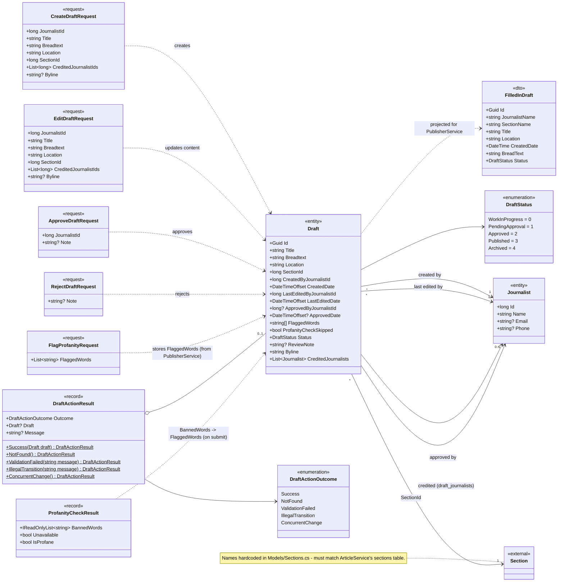

# L4 – DraftService: models

Code-level view of `apps/draft_service/src/DraftService/Models/` (`Draft.cs`, `Journalist.cs`),
`Handlers/DraftActionResult.cs` and the `ProfanityCheckResult` record in `Profanity/IProfanityClient.cs`.
See the L3 view `DraftServiceComponents` in Structurizr for how the components use these models.

## Notes

- **`Journalist`** is owned by DraftService (`journalists` table, `V2__add_journalists_and_credited_authors.sql`,
  exposed by `JournalistsController`). A draft can credit several journalists (`draft_journalists`);
  `Byline` is generated from them unless it is set manually.
- **`Id`** is a `Guid`, so the same id can follow the draft into ArticleService as `DraftId`.
- **`FilledInDraft`** is what PublisherService reads (`GET api/drafts/filled-in-draft/{id}`): byline and
  section resolved to names, so PublisherService doesn't need to know DraftService's tables.
- **Legal status transitions** between `DraftStatus` values are defined in `Workflow/DraftStatusTransitions.cs`
  (L3 component `DraftStatusTransitions`), not in the model itself.
- **`DraftActionResult`** carries a use-case outcome without depending on ASP.NET Core; `DraftsController`
  maps `DraftActionOutcome` to HTTP status codes.
- **`FlaggedWords`** is filled from ProfanityService on submit (early feedback for the editor) and by
  PublisherService when its check before publishing finds banned words. If ProfanityService can't answer
  on submit, the draft is still submitted with `ProfanityCheckSkipped = true`, so the editor is warned.
