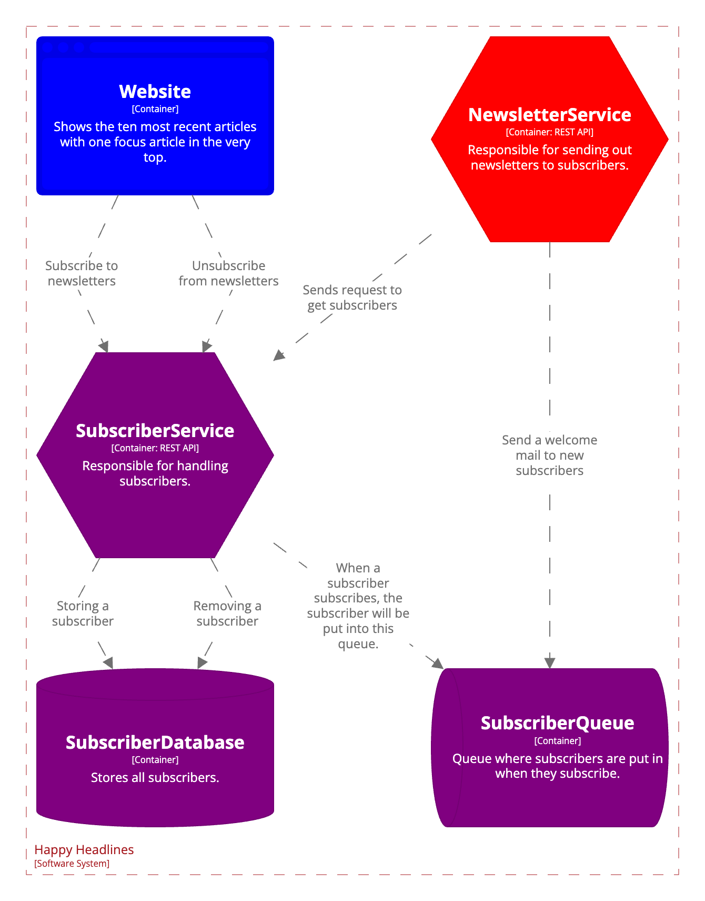

This week you're going to implement the SubscriberService and the corresponding database and queue. The NewsletterService and the SubscriberService are meant to be in each of it's own swimlanes and you are expected to implement fault isolation between between them.

The SubscriberService must also be hidden behind a release toggle, meaning that it must be possible to activate and deactivate the service without redeploying the application - neither entirely or partially.

Make sure to include all services below in your CI/CD-pipeline. You don't have to create the website.

